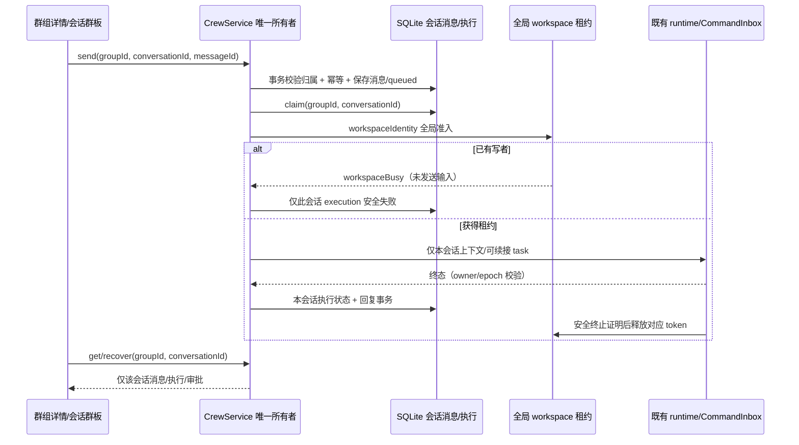

# Agent Crew 当前规范（P0.1 + P1）

## 范围与所有者

支持 ZCode 与已落地 P1 外部 runtime、共享工作目录及 manual/semi/auto 受控接力。计划确认、单目标最终标签、预算和暂停语义以 [RELAY.md](./RELAY.md) 为准；旧群默认 manual。worktree 和成本统计不在本次范围，P1 adapter 安全门槛继续适用。
CrewAgentCatalogService 是 Agent 定义唯一事实所有者；CrewService 是群组配置、成员引用、群板消息和执行记录唯一事实所有者。tasks-index 使用 agent*crew*\* 表，不复用 task_groups。
存储分为 agent_crew_agents、agent_crew_groups、agent_crew_members、agent_crew_conversations、agent_crew_messages、agent_crew_executions 与 agent_crew_workspace_leases。成员表只存引用与覆写，不重复保存 Agent 定义。
UI 经 ICrewService hook 读取投影和提交命令，不访问数据库，不从正文扫描 @ 触发任务。
成员保存稳定 agentId 引用；读取投影显示当前定义版本，派工 admission 解析最新定义。修改 catalog 或成员不改写已接受执行的审计快照。

## 接口与状态

- list/get/create/update/delete/duplicate/bind/send/recover；update 支持显式替换成员引用（运行中拒绝），仅重命名不重写成员。
- 新群可不绑定目录；duplicate 在事务中仅复制群配置与 Agent 引用，生成独立 groupId/memberId，binding=null、epoch=0，仅有空默认对话，无消息、执行、运行时会话和认证引用。
- bind 必须预检目录存在、绝对路径、identity 与远端标识一致以及权限；运行/排队/恢复未决时禁止重绑，成功递增 epoch。
- 用户消息使用客户端稳定 messageId，mentions 为零或一个 memberId。无 mention 只存群板；多个、未知成员以及不支持 runtime 一律拒绝。
- groupId+conversationId+messageId+memberId 唯一执行键；相同消息 ID 不同正文/mention 拒绝，不创建第二次执行。
- queued -> running -> succeeded/failed/cancelled；不确定执行归属进入 recovery_required，不能自动重放。
- 发送事务先持久化消息+queued 执行，然后抢占执行；执行前持久化 owner、成员快照和 task/session 引用，终态结果与群板回复原子写入。
- 角色提示词 + 本次消息之前同一绑定纪元最近 N 条群板（有界裁剪，不当作指令）+ 本次任务；结果正文的 @ 无任何调度能力。

## 租约和事件顺序

```text
用户 UI -> CrewService -> SQLite 消息/执行事务 -> runtime port
                                     -> 现有 task/session 创建
普通会话 -----------------------------> 统一 workspace 写准入
                                          | workspaceIdentity.trim() || workspacePath
                                          | SQLite 唯一租约 + owner + fencing token
                                          v
                                    现有 ZCode CommandInbox
                                          v
                                    runtime 终态/输入就绪
                                          v
                   群板回复/状态事务 <- 释放属于本轮的租约
```

全局租约覆盖同库多 Host、多群和普通会话入口，不使用超时过期当作安全回收依据。
仅能证明旧进程已退出或执行已安全终止才回收；无法证明时保留隔离并标记 recovery_required。
ACK 仅代表输入接收，不承诺 TurnStarted 已进入投影。释放租约前必须观察到本次 inputId/sourceCommandId 的权威执行行（仅 queue item 不算）；同时使用 ACK 后新建的独立订阅及其 initial snapshot 建立读取屏障；旧 subscriptionId、旧 epoch、倒退 seq 和缺帧不能证明空闲。明确拒绝只恢复前一次证明，传输未知/failed 不解除隔离。
旧执行结果不得修改新 token 的租约或新绑定纪元。队列重启可恢复未启动项；已启动写任务绝不自动重放。
Desktop continuous 与 Web replayable 仍走既有 session 执行与 owner 路由；群板为独立持久投影，不替代 session stream/snapshot。
P0 不引入手机专属 Agent、Host 或新远程会话；不支持的远程能力需显式拒绝而非路径 fallback。

## 验收与测试

1. 建群、增删成员、重命名、删除；复制后仍引用同一 Agent、独立成员 ID、绑定为空、历史为空。
2. 未绑定或运行中重绑被拒；新纪元 prompt 不包含旧目录历史。
3. 单成员派工且普通文本 @ 不触发；上下文有界；终态回复仅一次。
4. 两群和普通会话同 workspace 互斥；不同 identity 的同路径互不串租约；旧 token 不能释放新租约。
5. 重启恢复 queued；running 无安全归属转 recovery_required；重复发送/恢复不重复执行或回复。
6. UI 场景：独立创建 Agent -> 建群选择 catalog 成员并绑定 -> @ 芯片派工 -> 显示结果 -> 复制为待绑定群；手机窄屏可操作。
7. zh-CN/en-US 对齐；typecheck、lint、architecture:check --changed、核心服务及租约测试通过。

## 保留的执行能力边界

- 目录所在本地 Host 支持执行；显式拒绝远端 binding，不创建额外 Agent。普通 desktop-continuous/web-remote-replayable 的共用准入经过 fixture 验证，端到端手机联调不在本期验证范围。
- 所有成员（含只读）保守使用共享租约；ZCode 只读运行时仅开放 Read/Glob/Grep，并与 catalog 的 toolAllowlist 取交集，不靠提示词限制写权限。并行读/快照基线是后续优化。
- 跨群/普通会话竞争租约时，未开始的群执行保存为明确失败（workspaceBusy），不自动重试或丢弃用户消息；同群未启动输入持久排队。
- Unix 崩溃回收同时检查 Host 与 detached runtime 进程组；Windows 没有可持久恢复的进程树归属证明时保持 recovery_required，不按 PID/超时冒险抢锁。
- 缺可信 taskId 或进程归属的恢复记录需要安全调查，不提供绕过租约的强制清除入口。
- 群板是有界轮询投影；P0 没有新增业务广播/快照协议，保持既有会话通道语义。

## P0.1：独立 Agent catalog（覆盖早期成员定义快照模型）

### 产品规则、状态与契约

- Agent 是 Host/tasks-index 范围独立资产，与 runtime subagents 无关。`ICrewAgentCatalogService` 单独提供 list/get/create/update/delete；定义持久化在 `agent_crew_agents`。服务生成稳定 agentId、configVersion 和时间戳。
- Agent 定义包含 name、systemPrompt、runtime（沿用 P1 的 zcode / claude-cli / codex-cli / opencode-cli ID）、ModelSelection、默认 accessMode 和可选 toolAllowlist。toolAllowlist 是 ZCode 工具能力约束，不虚构 P1 外部 adapter 未提供的细粒度工具或模型控制；外部 runtime 的模型依旧由其原有 CLI 配置决定，UI 明示边界。
- `CrewMember` 仅保存 memberId、agentId 与可选 accessMode 覆写。同一 Agent 可加入多个群组；同一群组中不得重复引用同一 Agent。读权限 Agent 不可被群覆写提升为写权限。群组仅通过已有 catalog 选择成员，不提供新建 Agent/编辑定义入口。
- 建群、编辑、复制在同一数据库事务内校验引用存在；删除 Agent 在同一事务内检查所有群引用，有引用时拒绝并显示明确原因；删除群组不会删除 Agent。数据库外键禁止悬空引用。
- catalog 更新不重写群成员，不阻塞进行中的执行；群详情返回实时解析后的成员投影供显示（含当前 configVersion）。下一次新派工在入队事务内解析最新 Agent 定义、合并权限并保存执行审计快照；重复 messageId/恢复已接受执行仍使用原执行快照，不改变幂等边界。
- UI 分为独立「Agent 管理」与「群组管理」视图；创建群 = 选目录 + 从 catalog 多选成员 + 群内权限策略。成员卡片仅显示引用名称、runtime、当前版本与权限，不内嵌角色/模型编辑表单。

### 所有者与事件顺序

```text
Agent 管理 UI -> useCrewAgentCatalog -> ICrewAgentCatalogService -> agent_crew_agents
群组管理 UI  -> useCrew -> CrewService -> agent_crew_groups / agent_crew_members (agentId FK)
                                              |
用户 @ 派工 -> 同库入队事务: 读取引用 + 当前 Agent -> 有效权限 -> 执行审计快照
                                              v
                                   原 P0/P1 runtime port -> 原 owner/lease admission
                                              v
                                   原 CLI 执行事实 -> 原群板终态事务
```

catalog 是定义唯一所有者，CrewService 是引用、群板和执行唯一所有者。桌面 continuous 与手机 replayable 继续复用既有 RPC/Host/owner，新增 catalog 不创建 Agent 进程、队列或手机专属状态。

### 迁移边界与验收

- 通过 tasks-index migration 新增 catalog 表并抽取已有成员内嵌定义，更新 migration checksum 输入；不能仅修改历史 SQL 绕过迁移。
- 历史相同 agentId 且定义一致的成员共享抽取结果；同 agentId 存在不同定义时必须无损拆分为不同 catalog ID 并改写引用，不能任意覆盖。历史执行快照保留。
- 回归先锁定 catalog CRUD、严格引用校验、多群共享/更新生效、引用删除拒绝、删除群不删除资产、复制保留引用、旧库迁移与历史快照、权限缩减与执行幂等。
- 交互验收：独立创建两个 Agent -> 创建/绑定群 A -> 多选 Agent -> 创建群 B 引用同一 Agent -> 编辑 catalog -> 两群显示新定义 -> 拒绝删除被引用 Agent -> 移除全部引用后删除成功。
- 所有 crew 测试（包含现有 P1 runtime fixture）以及 typecheck/lint/architecture:check --changed 必须实际执行并报告；代码文件不超过 400 行，不更改 external-runtime adapters/contracts/bootstrap 实现，不提交 Git。

## 群组多会话（2026-09-25）

- 群组是可复用团队，持有成员 agentId 引用、权限与 workspaceBinding/epoch；不再以群组作为唯一消息流。会话是任务实例，持有独立消息序列、执行、审批投影和恢复边界。
- CrewService 仍是唯一业务所有者；SQLite 新增 agent_crew_conversations，消息和执行均持有 (groupId, conversationId)。UI 只保留选择、草稿和请求状态，不保存 accepted queue。
- 群组列表 list({}) 保持原语义；新增 createConversation/listConversations({groupId})，避免将团队列表与任务列表混在一个接口。get/send/recover/cancel/respondPermission 支持 conversationId。新 UI 必须显式携带会话 ID；兼容旧调用省略时只解析到本群固定默认会话，不使用当前选中或最近活跃会话。跨群 conversationId 必须拒绝。
- 会话 name 可为空（默认标题由 UI i18n 展示）；每个新群和迁移旧群均有一个 isDefault=true 会话；创建其他会话不复制消息、执行、taskId 或权限。
- 默认对话 ID 固定为 groupId，并保留 v5 的外部 runtime 原生 session 键，以满足既有 CLI 的续接同 sessionId 校验；其他对话把 conversationId 纳入键，互不复用原生历史。
- 幂等键为 groupId+conversationId+messageId+memberId，消息 sequence 按会话递增；上下文和 runtime resumeTaskId 仅允许同会话、同绑定纪元、同成员快照。
- 排队、claim、running/recovery_required、调度 job/requested key 按会话隔离。恢复 A 不检查或恢复 B 的执行；同群 B 的 recovery_required 不阻断 A 的会话级 admission。workspace 写租约仍以 workspaceIdentity.trim() || workspacePath 全局唯一，绝不按会话拆锁；明确 workspaceBusy 维持原有安全失败语义。
- 群组成员替换、删除与重绑仍检查全群未决执行，防止共享配置破坏另一个会话。群状态仅为聚合展示，群板派工门禁使用会话状态。
- 迁移 v6 纳入 tasks migration 事务和 checksumInput；重建消息/执行的复合唯一键及外键，把每群旧记录逐字段迁入默认会话，保留消息 ID、sequence、文本、执行状态、快照、owner/task 引用和时间戳。v4/v5 checksum 不变。
- UI 入口保持设置 → Agent 群组 → 群组管理 → 群组详情。详情呈现会话列表和新建对话；打开会话后复用 CrewBoard。切换时立即隐藏旧投影，过期异步请求不能覆盖新选择；草稿、审批和错误不得串会话。
- 归档不在本次必需范围；不改 CLI/runtime 协议，不引入新 Agent/Host，也不改变 Desktop continuous / Web replayable 的现有传输语义。



### 新增验收

1. 同群两会话可复用同一 messageId，消息/执行/sequence/上下文/续接均隔离。
2. A 的执行、审批、恢复不可通过 B 的参数访问或修改；跨群会话拒绝。
3. 重启仅恢复选中会话 queued，running 不确定项只标记本会话 recovery_required。
4. 真实 v5 数据迁移保留全部历史和租约；重复初始化不再复制记录。
5. 同 workspace 的跨会话写执行、普通会话仍全局互斥。
6. 交互 E2E 覆盖新建两个会话、切换、晚到响应、草稿和历史隔离；zh/en 文案对齐。

## 受控接力增量

群组接力配置、v7迁移、执行root/hop归属、计划批准和熔断场景参见 [RELAY.md](./RELAY.md)。`CrewService`仍是唯一状态所有者，`respondRelay`复用原enqueue/claim/runtime；普通@和中间输出不派工。执行成功与交接提案同事务，恢复未决优先隔离，权限人工批准不变。
