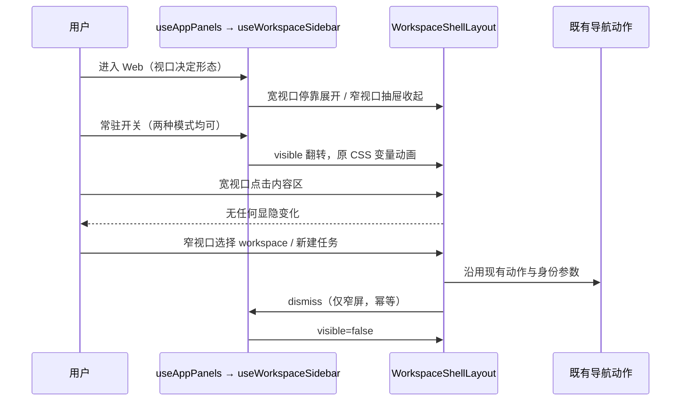
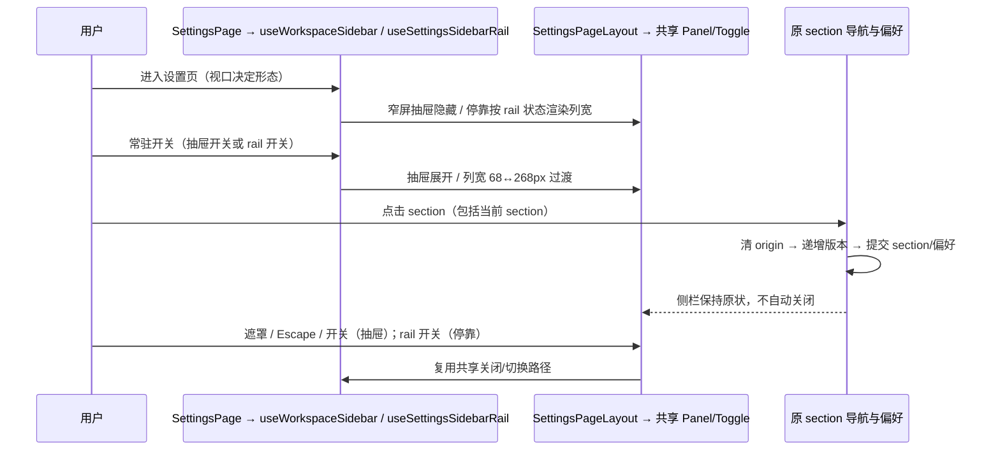

# Web 首页与设置页 WorkspaceSidebar

## 范围与平台形态

- WorkspaceShellLayout 是 CSS 变量驱动的 flex split；Electron（`isDesktop=true`）保持桌面分支：常驻侧栏列、拖拽/键盘调宽、localStorage 宽度记忆与快捷键，行为与视口无关。
- Web（非 Electron）按 1024px（Tailwind lg）分界，两种形态都有常驻开关：
  - **宽视口（≥1024px）停靠侧栏**：侧栏挤压内容、无遮罩，点击内容区不会收起侧栏；初始展开；顶栏左上角普通图标开关可收起/展开。
  - **窄视口（<1024px）覆盖抽屉**：侧栏覆盖内容并带遮罩，点遮罩/Escape/开关关闭；初始收起；顶栏左上角抽屉开关。
  - Bugfix 依据：桌面分支的收起按钮原本是 Electron 专属，Web 宽视口没有任何开关；而后备方案"Web 全视口走覆盖抽屉"会让点击内容区（遮罩）误关侧栏、设置页无法边看边操作。故回到视口分界，并补齐宽视口开关。
- 收起偏好仅属于当前 App 的 UI 状态，不持久化、不广播、不修改 workspace/session、owner/lease 或远程重放协议。

## 单一状态所有者与入口

- `useAppPanels` 委托 `useWorkspaceSidebar` 持有唯一的侧栏显隐状态；App 向 shell/快捷键/顶栏传递同一组状态和动作。
- 视口是只读外部信号，通过 SSR-safe 的订阅取得；服务端不访问 window/matchMedia，hydrate 首次快照与服务端一致（桌面语义）。客户端挂载同步应用窄屏规则。
- 用户显隐选择绑定所属视口模式，跨断点时采用目标模式默认值；桌面应用的模式始终不变。
- 开关常驻：停靠模式用顶栏普通图标开关（`workspaceSidebar.toggleSidebar`，快捷键标签随平台）；抽屉模式用 `MobileWorkspaceSidebarToggle`（触达区域至少 40×40px，aria-expanded/controls）。Electron 沿用 mac/Windows 自绘标题栏按钮与快捷键。

## 布局与交互

- 复用 `--workspace-sidebar-panel-width` / `--workspace-sidebar-width` 和现有 200ms width/opacity 动画。停靠模式收起后内容区不留宽度；抽屉模式覆盖内容，最大宽度保留 48px 外部关闭区域（`max-w-[calc(100%_-_3rem)]`）。
- 停靠模式点击内容区不触发任何显隐变化；只有用户点击开关（或快捷键）才收起/展开。抽屉模式可通过开关、外侧遮罩或 Escape 关闭；隐藏侧栏不可键盘聚焦，抽屉展开时底层内容不可交互。
- 首页导航语义：窄屏抽屉在成功派发 workspace 草稿导航、任务选择、新建任务或新建 conversation 后自动收起（选择即查看内容，属终态动作）；停靠模式导航不收起；导航校验失败的分支不误报成功。不能监听任意后台 session 更新来收起侧栏。
- 关闭动作幂等，不以 toggle 代替 close，避免连续导航重新打开。
- Electron 桌面按钮、快捷键、初始展开、侧栏拖拽/键盘调宽及 localStorage 宽度迁移保持不变；Web 不提供调宽操作、不覆盖桌面记忆宽度。

## 验收与验证

1. 320px / 390px / 768px / 1023px Web 为覆盖抽屉：初始隐藏、遮罩/Escape/开关可关、底层内容 inert；1024px / 1440px Web 为停靠侧栏：初始展开、无遮罩、点击内容区不收起。
2. 两种模式的开关常驻可反复切换；隐藏侧栏不进入 Tab 顺序；按钮至少 40px。
3. 窄屏抽屉选择不同或相同 workspace、新任务（含分组任务）、新 conversation、既有任务后自动关闭；停靠模式导航不收起；远程 identity 原样传递。
4. 桌面应用（Electron）在 390px 和 1440px 下保持桌面分支：初始展开、导航不自动收起、宽度记忆及快捷键不变。
5. 无 window / 无 matchMedia 的环境安全；SSR 渲染通过。
6. 可运行 Node 逻辑/SSR 回归 + 离线真实组件浏览器交互 fixture。后者不替代真实 Host、远程连接或手机视觉验收。
7. 执行 typecheck、lint、architecture:check --changed、既有 services/UI crew 与 SSR 回归；环境限制如实记录。

## 非目标

不更改手机远控的独立 shell、CLI、业务状态或依赖；不重构存量超长文件，仅作接线修改。所有新增实现与测试文件保持 ≤400 行。

## 设置页复用

- `SettingsPage` 调用同一个 `useWorkspaceSidebar(isDesktop)`，显隐状态仍只属于当前页面的 UI；首页与设置页不共享用户显隐选择，不增加 store、持久化或服务端事实。
- `SettingsPageLayout` 只承接布局：窄屏 Web 单列内容、高度跟随外框动态视口、复用 `WorkspaceSidebarPanel` 与 `MobileWorkspaceSidebarToggle`；宽屏 Web 与 Electron 桌面共用停靠 grid，列宽由 rail 状态驱动（见下）。
- 窄屏抽屉展开宽度 268px，沿用共享面板的 200ms width/opacity、48px 外部关闭区、遮罩、Escape 和焦点恢复；抽屉显示分组与文字，不能按 68px 图标 rail 渲染。
- **停靠侧栏（宽屏 Web 与 Electron）由 `useSettingsSidebarRail` 提供 68px 图标栏 ↔ 268px 完整导航的常驻开关**：默认值跟随视口（窄窗口默认 rail、宽窗口默认完整导航），跨断点重置为默认值，用户可随时手动切换；列宽状态驱动（不再用 `max-lg:` 媒体查询），带 200ms 过渡。
- **section 导航不自动收起侧栏**（任何形态）：section 切换只提交 section/偏好；停靠模式本就不因导航变化，抽屉模式由开关/遮罩/Escape 手动关闭。外部 intent 同样不得触发关闭。
- section、plugin origin、导航版本与导航 intent 继续由既有 SettingsPage 逻辑持有；导航按钮复用原 telemetry operation：先清理 plugin origin、递增导航版本、提交 section/偏好。
- SSR 继续使用共享 hook 的服务端快照，不新增 window 读取。Root 的首页在设置页下仍挂载且 inert，共享 Panel/Toggle 使用 panelId=settings-sidebar；焦点按 aria-controls 定位，inert 背景层不响应 Escape。

验收：390/768/1023（含小数断点）初始隐藏、开关/遮罩/Escape、内容不挤压、跨断点重置；1024/1440 Web 停靠展开、点击内容区不收起、rail 开关可切换 68/268px；Electron 原布局与快捷键不变；zh/en 与无 window SSR 通过。浏览器 fixture 不启动 Host/Agent，不替代真实设置服务与真机验收。
